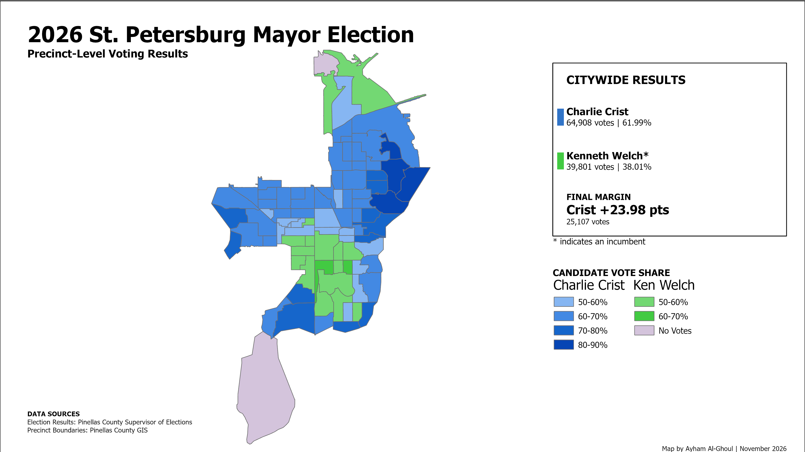

# Florida Maps

## 2026 St. Petersburg Mayoral Election

Former U.S. Representative and Governor Charlie Crist defeated the incumbent Mayor Kenneth Welch in the 2026 St. Petersburg Mayoral Election by 23.98 percentage points, receiving 61.99% of the vote citywide
